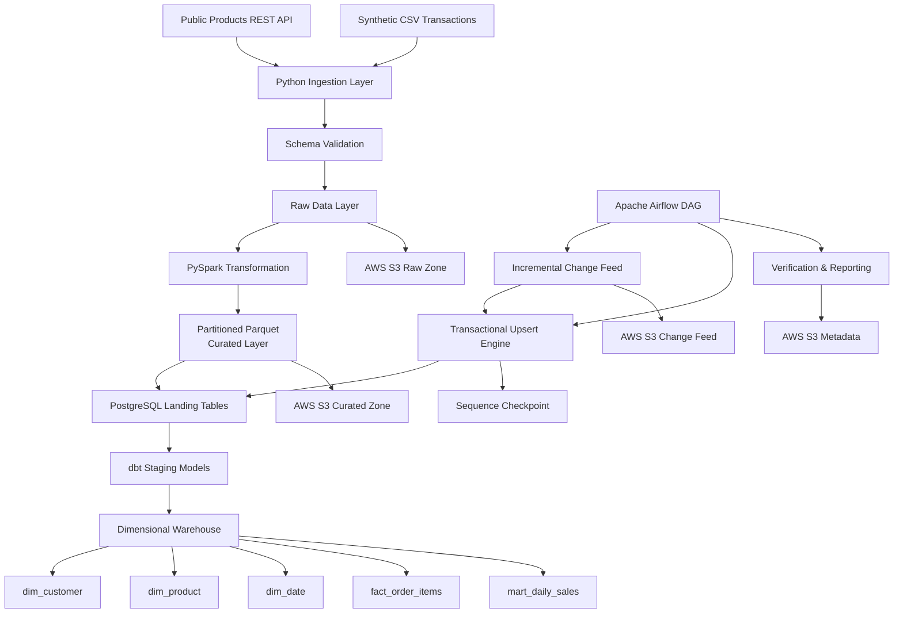
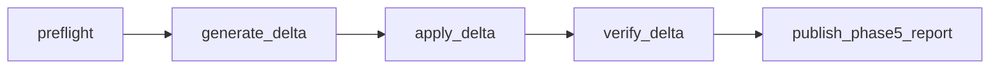

# 🛒 E-Commerce Data Lakehouse Pipeline

> End-to-end data engineering pipeline for ingesting, validating, transforming, modeling, incrementally updating, orchestrating, and publishing e-commerce data using **Python, PySpark, PostgreSQL, dbt, Apache Airflow, Docker, and AWS S3**.

---

## ✨ Overview

This project simulates a production-style e-commerce data platform that processes product, customer, order, and order-item data through multiple layers of a modern data engineering stack.

The pipeline combines:

- REST API and CSV ingestion
- schema and data-quality validation
- distributed transformations with PySpark
- partitioned Parquet storage
- PostgreSQL analytical warehousing
- dbt dimensional modeling and automated testing
- incremental upserts with transactional checkpoints
- Dockerized Apache Airflow orchestration
- AWS S3 cloud storage
- idempotent replay and failure-safe processing

The goal was to build the project around **data engineering fundamentals**, not just move data between tools.

---

## 🏗️ Architecture



---

## 🧰 Tech Stack

| Layer | Technologies |
|---|---|
| Programming | Python |
| Querying | SQL |
| Ingestion | REST APIs, CSV, JSON |
| Processing | PySpark |
| Data Lake Storage | Parquet |
| Warehouse | PostgreSQL |
| Transformation | dbt |
| Orchestration | Apache Airflow |
| Containerization | Docker, Docker Compose |
| Cloud Storage | AWS S3 |
| AWS SDK | Boto3 |
| Data Quality | Python validations, dbt tests |
| Incremental Processing | PostgreSQL upserts, sequence checkpoints |
| Version Control | Git, GitHub |

---

## 🚀 Key Features

### 🔌 Multi-Source Data Ingestion

The ingestion layer combines:

- product data from a public REST API
- synthetic customer CSV data
- synthetic orders
- synthetic order-item transactions

Each ingestion batch records metadata including:

- batch ID
- ingestion timestamp
- source
- row counts
- quality results
- source manifest

This separates **source timestamps** from **pipeline ingestion timestamps**.

---

### ✅ Data Contracts & Validation

Before records move downstream, the pipeline validates:

- required columns
- expected schemas
- null constraints
- primary-key uniqueness
- foreign-key relationships
- timestamps
- quantities
- order totals
- customer/order relationships
- order/order-item relationships

Invalid data prevents the batch from being published.

---

### ⚡ PySpark Transformation Layer

Raw records are transformed using PySpark.

The transformation layer performs:

- explicit schema enforcement
- type conversion
- normalization
- exact-row deduplication
- relationship validation
- financial-total validation
- order-context enrichment
- partition creation
- reliable temporary-output publication

Curated datasets are written as compressed **Snappy Parquet** files.

---

## 📂 Partitioned Data Layout

Orders and order items are partitioned by:

```text
order_year
order_month
```

Example:

```text
data/processed/initial_001/
│
├── customers/
│   └── part-*.snappy.parquet
│
├── products/
│   └── part-*.snappy.parquet
│
├── orders/
│   └── order_year=2026/
│       ├── order_month=1/
│       ├── order_month=2/
│       └── ...
│
└── order_items/
    └── order_year=2026/
        ├── order_month=1/
        ├── order_month=2/
        └── ...
```

Partitioning reduces the amount of data that downstream systems need to scan for time-based workloads.

---

## 🗄️ PostgreSQL Warehouse

Curated Parquet datasets are loaded into PostgreSQL using bulk-loading workflows.

The warehouse separates:

```text
Landing Layer
      ↓
dbt Staging Models
      ↓
Dimensional Models
      ↓
Analytics Mart
```

Landing tables preserve the transformed source-level records while dbt creates analytics-ready models.

---

## ⭐ Dimensional Data Model

The analytical model uses a star-schema style design.

### Dimensions

```text
dim_customer
dim_product
dim_date
```

### Fact Table

```text
fact_order_items
```

### Analytics Mart

```text
mart_daily_sales
```

---

### Fact Grain

The grain of `fact_order_items` is:

> **one row per order item**

For example:

```text
Order #1001
├── Keyboard    $20
└── Mouse        $5
```

The fact table stores:

```text
20
5
```

rather than repeating the complete `$25` order total on both rows.

This prevents double-counting during aggregation.

---

## 🧪 dbt Data Quality

The warehouse contains automated dbt tests covering:

- uniqueness
- non-null constraints
- referential integrity
- accepted values
- dimensional consistency
- fact-table grain
- order-total reconciliation
- source-to-fact reconciliation
- daily mart consistency

The project executes **46 dbt data tests** against the analytical layer.

Example custom tests:

```text
assert_order_totals.sql
assert_line_grain.sql
assert_fact_matches_source.sql
assert_customer_dimension.sql
assert_product_dimension.sql
assert_daily_mart.sql
```

---

## 🔄 Incremental Data Processing

The initial warehouse load contains:

```text
10,000 orders
25,069 order items
```

An incremental change feed then simulates:

```text
100 new orders
20 status updates
10 quantity corrections
```

After applying the incremental batch:

```text
10,100 orders
25,269 order items
```

Existing records are updated rather than duplicated.

---

## ♻️ Idempotent Upserts

Incremental records are written with PostgreSQL upsert semantics.

Conceptually:

```sql
INSERT INTO orders (...)
VALUES (...)
ON CONFLICT (order_id)
DO UPDATE SET ...;
```

This allows a batch to be safely replayed without creating duplicate business records.

---

## 📍 Transactional Checkpointing

Each simulated source event has a monotonically increasing sequence:

```text
change_seq
```

Example:

```text
1
2
3
...
130
```

The pipeline stores the latest committed sequence as a watermark.

The batch:

```text
data changes
+
applied-event records
+
batch metadata
+
checkpoint
```

is committed transactionally.

This prevents situations where:

- a checkpoint advances without the data being committed
- data commits but the pipeline incorrectly reprocesses the same events
- partial batches are left behind after failure

---

## 🔁 Replay Safety

After the incremental batch is applied:

```text
watermark = 130
```

Re-running the same batch detects the previous successful application and returns:

```text
already_complete
```

without modifying row counts.

This demonstrates **idempotent pipeline behavior**.

---

## 🌬️ Apache Airflow Orchestration

The project includes a Dockerized Apache Airflow DAG for coordinating incremental pipeline execution.

DAG:

```text
ecommerce_incremental_pipeline
```

Task flow:



### DAG responsibilities

#### `preflight`

Validates that the previous warehouse state is healthy before another incremental batch starts.

#### `generate_delta`

Creates a deterministic incremental change feed.

#### `apply_delta`

Runs the transactional incremental upsert workflow.

#### `verify_delta`

Validates the updated warehouse and analytical models.

#### `publish_phase5_report`

Publishes execution metadata for observability.

The DAG also includes:

- explicit task dependencies
- replay-safe batch IDs
- retry-compatible pipeline operations
- scheduled execution configuration
- single active DAG run protection
- Dockerized scheduler / API / DAG processor services

---

## ☁️ AWS S3 Data Lake

The project publishes pipeline artifacts to an actual AWS S3 bucket in:

```text
ap-south-1
```

The S3 layout separates logical data zones:

```text
ecommerce-data-lakehouse/
└── v1/
    │
    ├── raw/
    │   └── initial_001/
    │
    ├── curated/
    │   └── initial_001/
    │
    ├── change_feed/
    │   ├── delta_001/
    │   └── ...
    │
    └── metadata/
        └── reports/
```

The deployed cloud snapshot contains **60 objects** across the raw, curated, incremental-feed, and metadata layers.

---

## 🔐 S3 Security Configuration

The bucket is configured with:

```text
Public access blocking: Enabled
Bucket versioning:      Enabled
Default encryption:     AES-256 / SSE-S3
Object ownership:       BucketOwnerEnforced
```

AWS credentials are never stored inside the repository.

Local environment files are excluded through `.gitignore`.

---

## 🔎 S3 Integrity Verification

Before publication, each selected file is hashed locally with SHA-256.

The publisher stores the hash with the S3 object metadata.

A remote object is considered unchanged only if:

```text
remote content length == local content length
AND
remote SHA-256         == local SHA-256
```

This provides stronger replay validation than checking filenames alone.

---

## ♻️ Idempotent Cloud Publishing

The S3 publisher compares local objects against their remote versions before uploading.

First deployment:

```text
Selected: 60
Uploaded: 60
```

Subsequent publication can skip unchanged objects instead of blindly uploading the entire dataset again.

---

# 📊 Pipeline Results

| Metric | Result |
|---|---:|
| Products | 194 |
| Customers | 1,000 |
| Initial Orders | 10,000 |
| Initial Order Items | 25,069 |
| Incremental Events | 130 |
| New Orders | 100 |
| Updated Orders | 30 |
| Final Orders | 10,100 |
| Final Order Items | 25,269 |
| dbt Tests | 46 |
| S3 Objects Published | 60 |

---

# 📁 Repository Structure

```text
ecommerce-data-lakehouse/
│
├── dags/
│   └── ecommerce_incremental_pipeline.py
│
├── dbt/
│   └── ecommerce/
│       ├── models/
│       │   ├── staging/
│       │   └── marts/
│       └── tests/
│
├── docker/
│   ├── phase3/
│   └── phase5/
│
├── docs/
│   ├── DATA_CONTRACTS.md
│   ├── VALIDATION.md
│   └── PHASE*_VALIDATION.md
│
├── sql/
│   ├── phase3_queries.sql
│   └── phase4_queries.sql
│
├── src/
│   ├── cloud/
│   ├── extract/
│   ├── incremental/
│   ├── load/
│   ├── orchestration/
│   └── transform/
│
├── tests/
│
├── tools/
│
├── compose.phase2.yml
├── compose.phase3.yml
├── compose.phase4.yml
├── compose.phase5.yml
│
├── run_phase2.cmd
├── run_phase3.cmd
├── run_phase4.cmd
├── run_phase5.cmd
├── run_phase6.cmd
│
├── requirements.txt
├── requirements-phase6.txt
│
└── README.md
```

---

# 🧠 Engineering Decisions

## Why `order_items` is the fact-table grain

Orders can contain multiple products.

Using the order header as the analytical fact would lose product-level detail.

Using individual lines allows:

- product revenue analysis
- quantity analysis
- customer-product analysis
- daily aggregation
- order reconstruction

---

## Why Parquet

Parquet provides:

- columnar storage
- efficient analytical reads
- compression
- schema preservation
- compatibility with Spark and cloud analytics ecosystems

---

## Why PostgreSQL + dbt

PostgreSQL provides a realistic relational warehouse target while dbt separates:

```text
data movement
```

from:

```text
analytical transformation
```

This makes transformations version-controlled, testable, and easier to maintain.

---

## Why Sequence-Based Checkpoints

Timestamps alone can be ambiguous because multiple events may share the same timestamp.

A monotonically increasing sequence provides an explicit ordering:

```text
event 128
event 129
event 130
```

The timestamp still describes when a business record changed, while the sequence tracks ingestion progress.

---

## Why Separate Landing and Analytics Schemas

Landing tables preserve source-level records.

Analytical schemas can evolve independently through dbt without changing ingestion behavior.

```text
landing
    ↓
staging
    ↓
dimensions + facts
    ↓
marts
```

---

## Why Separate Raw and Curated S3 Zones

Raw storage preserves source-level inputs.

Curated storage contains validated Parquet optimized for downstream consumption.

```text
raw
 ↓
processing
 ↓
curated
```

This allows transformation logic to evolve without losing the original dataset.

---

# 🧪 Testing Strategy

The project contains multiple testing layers.

### Unit Tests

Test pure transformation and validation logic.

### Spark Integration Tests

Validate actual PySpark processing behavior.

### PostgreSQL Integration Tests

Validate warehouse loading and transaction behavior.

### dbt Tests

Validate analytical models.

### Incremental Pipeline Tests

Validate:

- insert behavior
- update behavior
- rollback
- duplicate prevention
- checkpoint advancement
- replay safety

### Airflow DAG Tests

Validate DAG import and dependency structure.

### S3 Publisher Tests

Validate:

- key mapping
- prefix safety
- secret exclusion
- cloud object selection

---

# ▶️ Running the Project

> Commands below assume Windows CMD and Docker Desktop.

---

## 1️⃣ Python Environment

```cmd
python -m venv .venv
```

```cmd
.venv\Scripts\activate.bat
```

```cmd
python -m pip install -r requirements.txt
```

---

## 2️⃣ Initial Ingestion

```cmd
python src\run_phase1.py --batch-id initial_001 --customers 1000 --orders 10000
```

---

## 3️⃣ PySpark Transformation

```cmd
run_phase2.cmd --self-test
```

```cmd
run_phase2.cmd --batch-id initial_001
```

---

## 4️⃣ PostgreSQL + dbt

Initialize local configuration:

```cmd
python tools\init_phase3_env.py
```

Start the warehouse:

```cmd
docker compose --env-file .env.phase3 -f compose.phase3.yml up -d --wait warehouse
```

Run:

```cmd
run_phase3.cmd --batch-id initial_001
```

---

## 5️⃣ Incremental Loading

Bootstrap the incremental warehouse:

```cmd
run_phase4.cmd --bootstrap --baseline-id initial_001
```

Generate a change feed:

```cmd
run_phase4.cmd --generate-demo --batch-id delta_001
```

Apply:

```cmd
run_phase4.cmd --batch-id delta_001
```

Verify:

```cmd
run_phase4.cmd --batch-id delta_001 --verify-only
```

---

## 6️⃣ Apache Airflow

Initialize Airflow configuration:

```cmd
python tools\init_phase5_env.py
```

Build:

```cmd
run_phase5.cmd --build
```

Start:

```cmd
run_phase5.cmd --start
```

Run DAG validation:

```cmd
run_phase5.cmd --self-test
```

Airflow UI:

```text
http://localhost:8080
```

Trigger a deterministic batch:

```cmd
run_phase5.cmd --trigger airflow_001
```

Stop services when finished:

```cmd
run_phase5.cmd --stop
```

---

## 7️⃣ AWS S3

Install AWS dependencies:

```cmd
python -m pip install -r requirements-phase6.txt
```

Configure an AWS CLI profile:

```cmd
aws configure --profile de-portfolio
```

Generate project cloud configuration:

```cmd
python tools\init_phase6_env.py --region ap-south-1 --profile de-portfolio
```

Initialize the S3 bucket:

```cmd
run_phase6.cmd --init-bucket
```

Preview publication:

```cmd
run_phase6.cmd --dry-run
```

Publish:

```cmd
run_phase6.cmd --publish
```

---

# 🔒 Secrets & Git Safety

The repository intentionally excludes:

```text
.env
.env.*
.venv/
data/
reports/
logs/
AWS credentials
Docker volumes
dbt build artifacts
```

Never commit:

- AWS access keys
- AWS secret keys
- generated database credentials
- Airflow authentication secrets

---

# 📚 Data Provenance

The project uses a mixture of public test data and deterministic synthetic data.

### Products

Retrieved from a public test-data REST API.

### Customers

Deterministically generated synthetic records.

### Orders

Deterministically generated synthetic transactions.

### Order Items

Synthetic transaction lines associated with generated orders.

### Incremental Changes

Simulated change events used to demonstrate incremental processing, checkpointing, upserts, and replay safety.

The project does **not** represent real customer transactions.

---

# ⚠️ Scope & Limitations

This project intentionally focuses on core data engineering patterns.

It does not currently implement:

- Apache Iceberg
- Delta Lake
- Apache Hudi
- Kafka
- database log-based CDC
- Redshift
- AWS Glue
- Kubernetes
- Slowly Changing Dimension Type 2
- deletion propagation
- production HA Airflow infrastructure

The curated data layer uses **plain partitioned Parquet**, not an ACID table format.

---

# 💡 What This Project Demonstrates

This repository demonstrates practical understanding of:

```text
ETL / ELT
Data ingestion
Data contracts
Schema enforcement
Data quality
PySpark
Partitioned storage
Parquet
Relational warehousing
Dimensional modeling
Fact-table grain
dbt
SQL testing
Incremental loading
Upserts
Transactional processing
Checkpointing
Idempotency
Workflow orchestration
Docker
AWS S3
Cloud security
Object integrity validation
```

---

# 🧑‍💻 Author

**Rahul Pandey**

Computer Science undergraduate interested in **Data Engineering, Data Platforms, Analytics Engineering, and scalable data systems**.

---

## ⭐ If you found this project useful

Feel free to explore the pipeline architecture, dbt models, validation framework, incremental-processing implementation, and cloud-publishing layer.